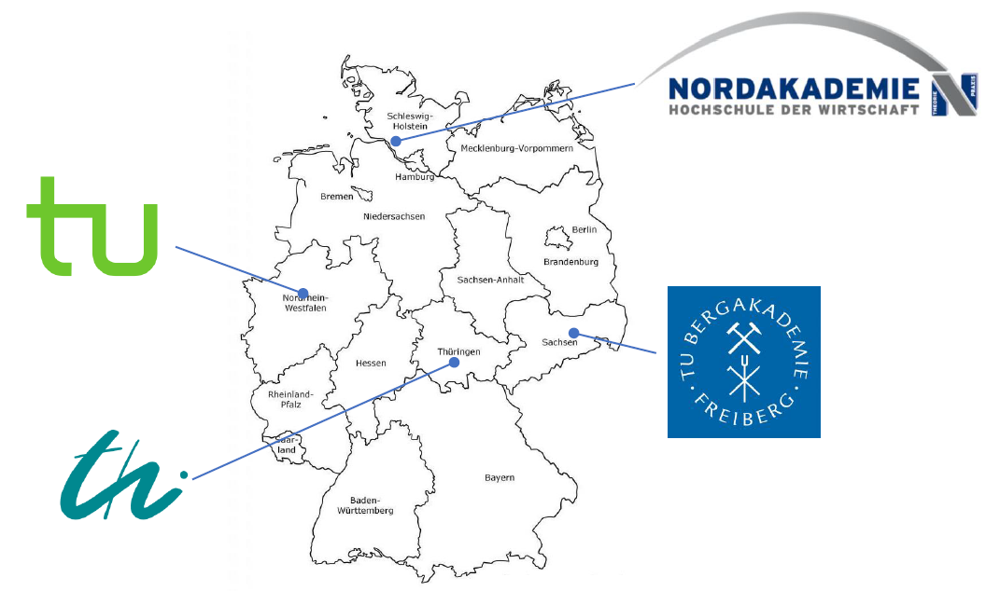
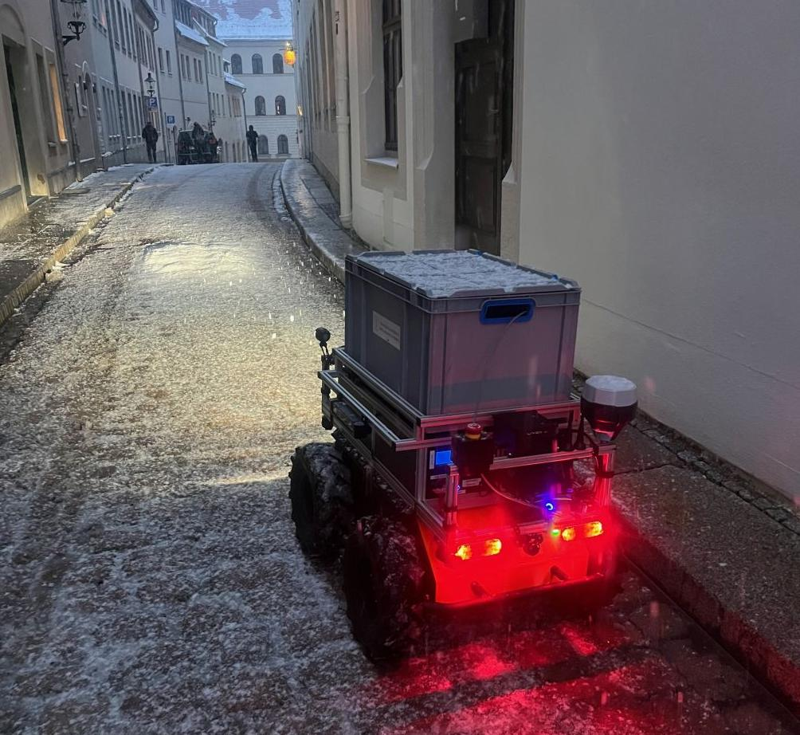
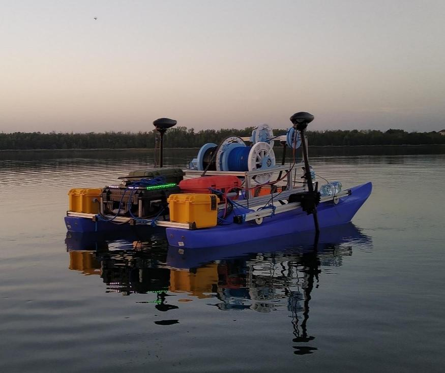
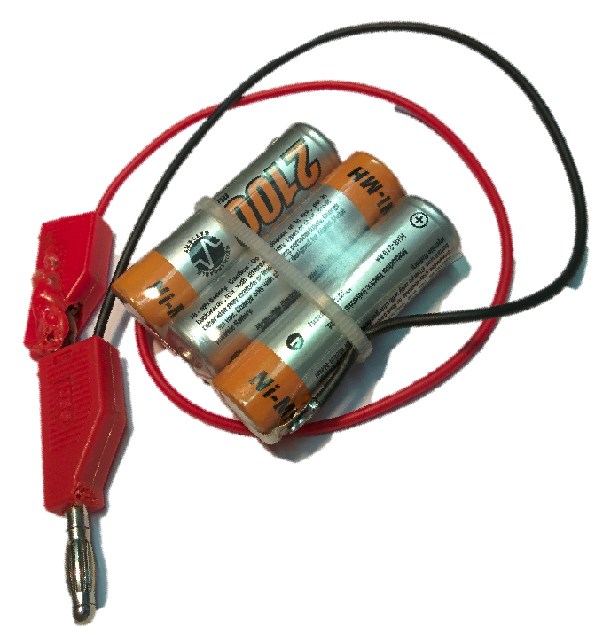
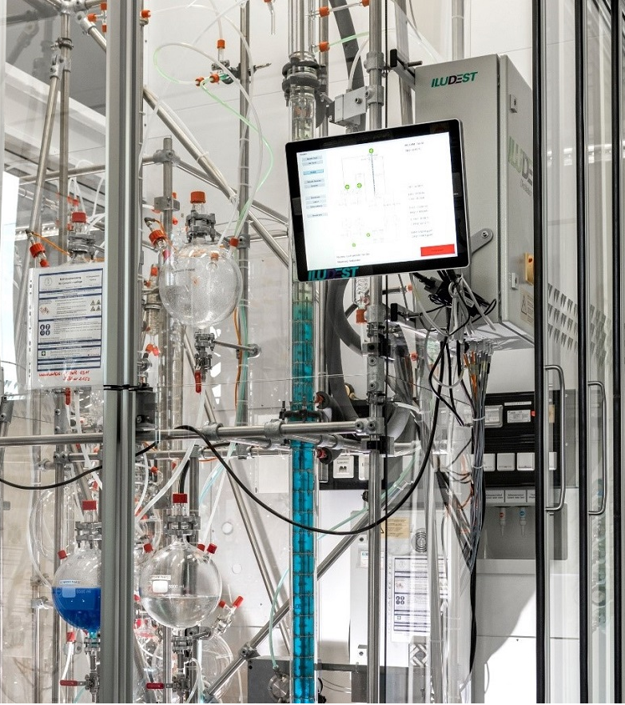
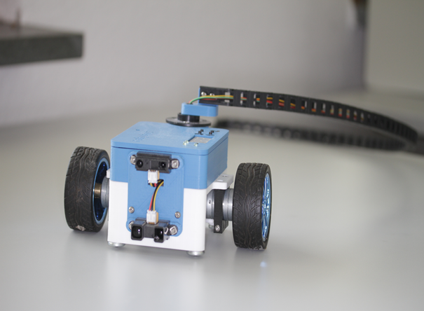
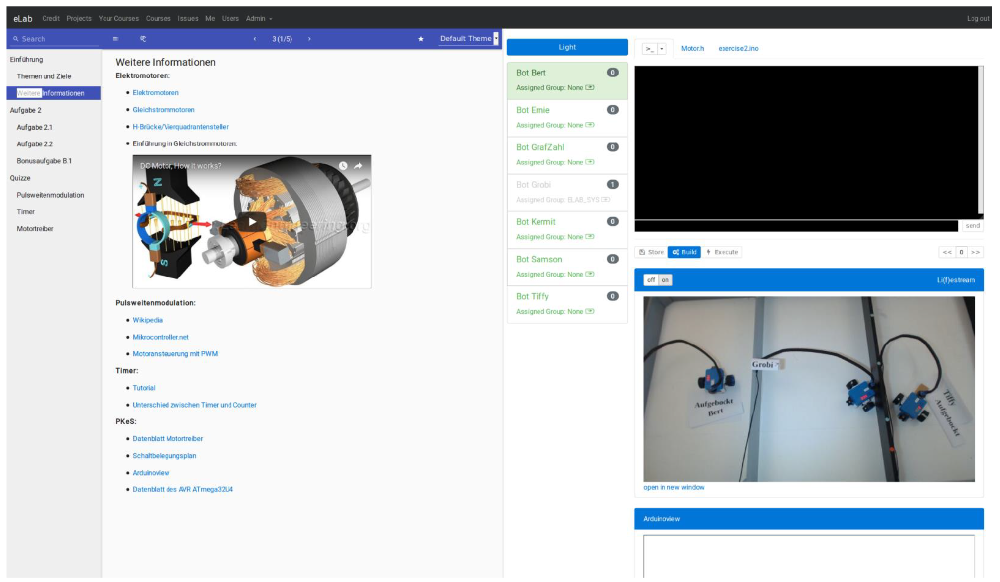
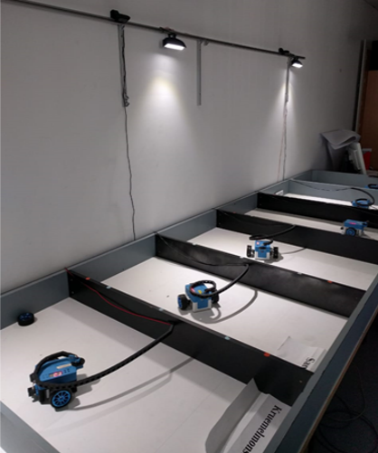
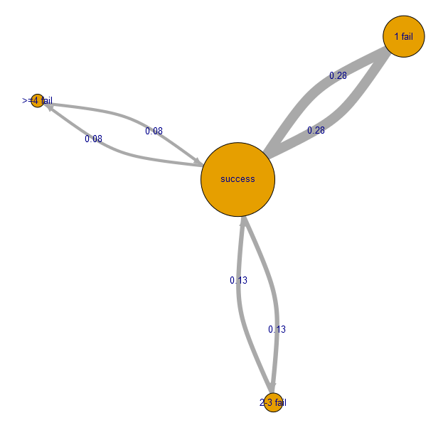

<!--
author:   Sebastian Zug; André Dietrich; Jihad Hyadi; Ines Aubel

email:    sebastian.zug@informatik.tu-freiberg.de

version:  1.0.0

language: en

narrator: UK English Female

icon:     https://tu-freiberg.de/sites/default/files/styles/large_xl/public/2024-06/Logo1.png?itok=DwUdy4lK

link:     style.css

import:   https://raw.githubusercontent.com/LiaTemplates/LiveEdit-Embeddings/refs/tags/0.0.1/README.md

@style
.flex-container {
    display: flex;
    flex-wrap: wrap;
    align-items: stretch;
    gap: 20px;
}

.flex-child {
    flex: 1;
    margin-right: 20px;
}

@media (max-width: 600px) {
    .flex-child {
        flex: 100%;
        margin-right: 0;
    }
}

.qr {
    text-align: center;
}
@end

@qr: 

-->

[](https://liascript.github.io/course/?https://raw.githubusercontent.com/Cross-Lab-Project/presentations/main/Ukraine_Delegation_2026/presentation.md#1)

# From Text to Real Hardware

Edrys – Open Source Remote Labs from Freiberg
--------------------------------------------

<section class="flex-container">

<div class="flex-child" style="width: 34%; max-width: 400px">

| CrossLab partners        |
| ------------------------ |
| TU Bergakademie Freiberg |
| TU Ilmenau               |
| TU Dortmund              |
| Nordakademie             |

</div>

<!-- class="flex-child" -->


</section>

<!-- style="font-weight: bold" -->
Prof. Dr. Sebastian Zug, Dr. André Dietrich, Jihad Hyadi, Dr. Ines Aubel \
RoboLab, TU Bergakademie Freiberg \
November 2026

---

> This presentation is an Open Educational Resource (OER) under [CC BY 4.0](https://creativecommons.org/licenses/by/4.0/). All materials are available at https://github.com/Cross-Lab-Project/presentations/tree/main/Ukraine_Delegation_2026

## Who we are

Software Engineering and Robotics Group – TU Bergakademie Freiberg

<section class="flex-container">

<div class="flex-child" style="min-width: 250px;">

__Research field 1: Robotics__




</div>

<div class="flex-child" style="min-width: 250px;">

__Research field 2: Digital teaching__

We develop open source tools for teaching:

- [LiaScript](https://liascript.github.io): interactive courses written as plain text (since 2017)
- [Edrys](https://edrys-labs.github.io): browser-based remote labs and classrooms (since 2021)

</div>

</section>

    {{1}}
> __Our question:__ How do we teach topics that need a lot of real hardware?

## Step 1: Teaching material as text

> __LiaScript__ is a Markdown dialect for interactive online courses. Everything is plain text: easy to share, to translate, to version with git and to adapt. It runs in the browser, works offline and needs no server.

    --{{0}}--
The editor shows the source, the preview shows what learners see. Change the text and watch the course update.

```markdown @embed.style(height: 550px; min-width: 100%; border: 1px black solid)
# From text to course

__Mathematics__

$U = R \cdot I$

__Tables become charts__

| Current I in mA | Voltage U in V |
| --------------: | -------------: |
|               0 |              0 |
|              10 |              1 |
|              20 |              2 |
|              30 |              3 |

__Speech__

> {{|> UK English Female}}
> Markdown is a lightweight markup language and the starting point of LiaScript.

__Quizzes__

What is the voltage across a 100 Ω resistor at 20 mA?

- [( )] 0.2 V
- [(X)] 2 V
- [( )] 20 V
```

> Try it yourself: https://liascript.github.io/LiveEditor/

### Even hardware can be simulated

    --{{0}}--
LiaScript can even run a simulated Arduino in the browser. Press the run button and the LEDs blink.

````markdown @embed.style(height: 550px; min-width: 100%; border: 1px black solid)
<!--
import: https://raw.githubusercontent.com/liaTemplates/AVR8js/main/README.md
-->

# Simulated Arduino

<div id="example">
<wokwi-led color="red"   pin="13" label="13"></wokwi-led>
<wokwi-led color="green" pin="12" label="12"></wokwi-led>
<wokwi-led color="blue"  pin="11" label="11"></wokwi-led>
<wokwi-led color="blue"  pin="10" label="10"></wokwi-led>
<span id="simulation-time"></span>
</div>

``` cpp
byte leds[] = {13, 12, 11, 10};
void setup() {
  Serial.begin(115200);
  for (byte i = 0; i < sizeof(leds); i++) {
    pinMode(leds[i], OUTPUT);
  }
  Serial.print("Running LED started ... ");
}

int i = 0;
void loop() {
  digitalWrite(leds[i], HIGH);
  delay(250);
  digitalWrite(leds[i], LOW);
  i = (i + 1) % sizeof(leds);
}
```
@AVR8js.sketch(example)
````

    {{1}}
> __Is a simulation enough for engineering students?__

### ... but engineers need real hardware

<section class="flex-container">

<div class="flex-child" style="min-width: 250px;">

> __Teaching in science and engineering lives from interaction with real systems!__

A simulation does not show

- sensor noise and component tolerances,
- real timing, latencies and interrupts,
- empty batteries, loose cables and broken parts,
- the moment when the robot simply does not move.

</div>

<div class="flex-child" style="min-width: 250px;">

<!-- width="80%" -->

<!-- width="80%" -->

</div>

</section>

## Step 2: Remote laboratories

> __Definition:__ Remote labs give access to real hardware over the internet, without being physically close to the devices.

Our first own remote lab, 2019:





!?[Industrial eLab - Demo](https://www.youtube.com/watch?v=bICfKRyKTwE "eLab - remote access lab at Otto-von-Guericke University Magdeburg")

<!-- class="highlight" -->
> __Project:__ Industrial eLab, BMBF (2017–2020), TU Bergakademie Freiberg, Otto-von-Guericke University Magdeburg

### Lessons learned

| Advantages                                                  | Disadvantages                                         |
| :---------------------------------------------------------- | :---------------------------------------------------- |
| Learners work with real hardware, any time                  | No immediate support by a tutor, as in a lab          |
| Development environment fits the task perfectly             | Technical effort for installation and maintenance     |
| Learning analytics help to improve the course               |                                                       |

    {{1}}
<section>

But the concept itself had limits:

> __Challenge 1: No flexibility__ – changing tasks or adding new examples needed experts.

> __Challenge 2: Limited usage__ – intensive use in a few weeks of the semester, almost none in the rest of the year.

> __Challenge 3: Narrow view__ – only remote access, no combination with simulations, videos or other formats.

``` ascii
  Laboratory Level                   Monolithic
                          Server-Infrastructure          Learner's View
  n Instances   .--------------------------------.
                |                                |         m Instances
                                                                 .
      +-----------------+         +-----------------+            .
      | Instrumentation |░        |    Management   |░           .
      +--------.        |░        +--------.        |░
 +-----------+  \       |░   +-----------+  \       |░   +----------------+
 | 👩🏻‍🔬 Actual  \  \      |--->|  Gateway   \  \      |--->|  Web Browser   |
 | Laboratory /  /      |<---|     🖥     /  /      |<---|      🧑‍💻        |
 +-----------+  /       |░   +-----------+  /       |░   +----------------+
      +--------'        |░        +--------'        |░   Student's Computer
      |                 |░        |                 |░
      +-----------------+░        +-----------------+░
        ░░░░░░░░░░░░░░░░░░          ░░░░░░░░░░░░░░░░░░
```

</section>

<!-- class="reference" -->
> __Reference:__ Ines Aubel et al., _Adaptable Digital Labs – Motivation and Vision of the CrossLab Project_, GeCon 2022, [Link](https://www.researchgate.net/publication/365384986_Adaptable_Digital_Labs_-_Motivation_and_Vision_of_the_CrossLab_Project)

## Step 3: Edrys – labs as building blocks

> __Idea:__ Treat a lab like a LiaScript course. A lab is a __text file__ that combines reusable __modules__.

```ascii
       Existing                         Learning Scenario
Module Implementations                    Configuration
    from the Web                        (YAML text file)
          |                                     |
          +------------------+------------------+
                             |
                             v
                   +-----------------+
                   | Browser based   |░
                   | Lab control     |░
                   +--------.        |░
              +-----------+  \       |░
              | 👩🏻‍🔬 Actual  \  \      |-->
              | Laboratory /  /      |<--
              +-----------+  /       |░
                   +--------'        |░
                   |                 |░
                   +-----------------+░
                     ░░░░░░░░░░░░░░░░░░
```

    {{1}}
| [Modules](https://github.com/edrys-labs) (examples) | Purpose                                         |
| --------------------------------------------------- | ----------------------------------------------- |
| Markdown, LiaScript                                 | Instructions, tasks, quizzes                    |
| Monaco code editor                                  | Programming, shared between users               |
| MicroPython / AVR8js simulator                      | Prepare and test without hardware               |
| Camera stream                                       | See the real device                             |
| Terminal, serial monitor                            | Flash and run code on the device                |
| Whiteboard, chat, video call, survey                | Collaboration and feedback                      |

### One module = a few lines of text

```yaml   esp32_lab_en.yaml (excerpt)
name: Arduino Nano ESP32 Lab (English)
modules:
  - url: https://edrys-labs.github.io/module-markdown-it/index.html
    config:
      content: |-
        # Welcome to the Arduino Nano ESP32 Remote Lab
        ...
    showInCustom: lobby

  - url: https://edrys-labs.github.io/module-monaco-editor/
    config:
      language: cpp
      runCommand: execute
    showInCustom: station

  - url: https://edrys-labs.github.io/module-streaming/index.html
    stationConfig:
      video: true
    showInCustom: station

  - url: https://edrys-labs.github.io/module-pyxtermjs/index.html
    stationConfig:
      server: http://localhost:5000/pty
      workflow: arduino-nano-esp32
    showInCustom: station
```

    {{1}}
<section>

What follows from that:

- __Adapting a lab__ means editing text, not reprogramming a system.
- __Translating a lab__ means translating text. We translated our German Calliope lab into English in a few minutes.
- __Changing the hardware__ means changing a few lines: the same lab structure works for Arduino, ESP32, Calliope, STM32 or a Linux terminal.
- __Sharing a lab__ means sharing a file, on GitHub, as OER.

</section>

### Serverless: peer-to-peer

> Classical remote labs need a central server infrastructure. Edrys connects the browsers directly.

``` ascii
Classical server-based setup                 Serverless peer-to-peer setup

      👨🏾‍💻 --.     .-- 👩‍💻                          - - - --👨🏾‍💻-----👩‍💻
            \   /                                              /  \
                                                              /    \
  👩‍💻 ------  🖥️  ------ 👨🏾‍💻                           👩‍💻------+-----👨🏾‍💻- - -
                                                       \    /      /
            /   \                                       \  /      /
      👨🏾‍💻 --'     '-- 👩‍💻                                  👨🏾‍💻     👩‍💻- - - -
```

    {{1}}
<section>

| A station needs ...                                   | ... and no                         |
| ----------------------------------------------------- | ---------------------------------- |
| a computer with Chrome or Edge (WebSerial, WebRTC)    | own server or cloud contract       |
| the device on USB, a webcam                           | public IP address or port opening  |
| optionally Docker for terminal / flashing tools       | software installation for students |

> Edrys itself is a static web page (GitHub Pages). Every station can be operated and maintained by the people who own the hardware.

</section>

## Live demo: a remote lab in five minutes

> __Grab your phone or laptop!__

    --{{0}}--
I now turn my own laptop into a remote lab station, with an Arduino Nano ESP32 plugged in right here.

1. Import the lab description `esp32_lab_en.yaml` into Edrys.
2. Open a second browser window as __station__: Arduino Nano ESP32 on USB, webcam on the board, a Docker container with `arduino-cli`.
3. You join the classroom with the QR code below.
4. Station: change the C++ code and press run. It is compiled and uploaded to the real board.
5. Watch the RGB LED in the stream and the output in the serial monitor.

Classroom link for the demo:

<script input="text" placeholder="paste the classroom URL here" aria-label="classroom URL for the live demo" style="display: block">
let url = "@input".trim()
url === ""
  ? "Paste the classroom URL to show its QR code."
  : "HTML: "
</script>

### Running in everyday teaching

These labs are used in our courses on embedded systems. The tasks are in German, the hardware runs around the clock.

<section class="flex-container">

<div class="flex-child" style="min-width: 250px;">

__Interrupts and timers__ (LED ring)

@qr(https%3A%2F%2Fedrys-labs.github.io%2F%3F%2Fclassroom%2FsEHRNUR9TnhA8wYs)

https://edrys-labs.github.io/?/classroom/sEHRNUR9TnhA8wYs

</div>

<div class="flex-child" style="min-width: 250px;">

__Calliope mini lab__ (MicroPython and sensors)

@qr(https%3A%2F%2Fedrys-labs.github.io%2F%3F%2Fclassroom%2Fj83SVIVcOd5ARUtd)

https://edrys-labs.github.io/?/classroom/j83SVIVcOd5ARUtd

</div>

</section>

> Each station is used by one person at a time. A course runs several identical stations in parallel.

## CrossLab across borders

> __Vision:__ Universities share their labs. Students in Freiberg use a station in Ukraine, Ukrainian students use our stations, and both sides develop the tasks together.

<section class="flex-container">

<div class="flex-child" style="min-width: 250px;">

__What we can offer__

- Edrys and all modules as open source
- ready-to-use lab descriptions as OER, e.g. [edrys-labs on GitHub](https://github.com/edrys-labs)
- access to our stations in Freiberg
- support in setting up the first station

</div>

<div class="flex-child" style="min-width: 250px;">

__Possible next steps__

1. Try our labs from your campus with your students.
2. Set up one pilot station with your hardware.
3. Develop a shared lab with tasks in English and Ukrainian.
4. Exchange of students and lecturers around the labs.

</div>

</section>

    {{1}}
<section>

Which of your labs could you imagine sharing with other universities?

[[___ ___ ___]]

</section>

## Contacts and links

| Resource                       | Link                                  |
| ------------------------------ | ------------------------------------- |
| Edrys                          | https://edrys-labs.github.io          |
| Edrys source code and labs     | https://github.com/edrys-labs         |
| LiaScript                      | https://liascript.github.io           |
| CrossLab project               | https://cross-lab.org                 |
| This presentation              | https://github.com/Cross-Lab-Project/presentations/tree/main/Ukraine_Delegation_2026 |

__Deploy the English labs yourself:__

- [Arduino Nano ESP32 lab](https://edrys-labs.github.io/?/deploy/https://raw.githubusercontent.com/Cross-Lab-Project/presentations/main/Ukraine_Delegation_2026/esp32_lab_en.yaml) (from the live demo)
- [Calliope mini lab](https://edrys-labs.github.io/?/deploy/https://raw.githubusercontent.com/Cross-Lab-Project/presentations/main/Ukraine_Delegation_2026/calliope_lab_en.yaml) (MicroPython, with simulator)

__Contact at TU Bergakademie Freiberg__

| Name                    | E-mail                                   |
| ----------------------- | ---------------------------------------- |
| Prof. Dr. Sebastian Zug | Sebastian.Zug@informatik.tu-freiberg.de  |
| Dr. André Dietrich      | Andre.Dietrich@informatik.tu-freiberg.de |
| Jihad Hyadi             |                                          |
| Dr. Ines Aubel          | Ines.Aubel@chemie.tu-freiberg.de         |

<!-- class="highlight" -->
> __Project:__ [CrossLab](https://stiftung-hochschullehre.de/projekt/crosslab/) – Flexibly combinable cross-reality labs in higher education, Stiftung Innovation in der Hochschullehre (2021–2025) – TU Bergakademie Freiberg, TU Ilmenau, TU Dortmund, Nordakademie
